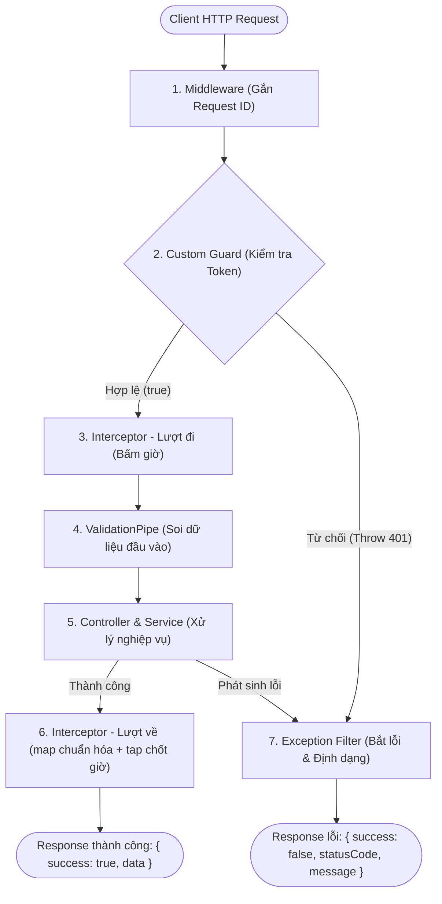

# Mục tiêu học tập — Hands-on Lab NestJS Request Lifecycle

Tài liệu này xác định rõ những gì bạn sẽ hiểu và tự tay làm được sau khi hoàn thành bài lab **"Kiểm soát Request Lifecycle với Custom Guard, Interceptor và Exception Filter"** trong khoảng thời gian từ **30 đến 45 phút**.

---

## 1. Bức tranh tổng thể

Trong các framework backend truyền thống như Express thuần, mọi logic thường bị nhồi nhét vào ba chỗ: middleware, controller và service. Khi ứng dụng phình to, controller trở nên quá tải vì vừa phải kiểm tra token, vừa lo ép kiểu dữ liệu, vừa xử lý nghiệp vụ, vừa bọc `try/catch` để format lỗi.

NestJS giải quyết triệt để sự lộn xộn này bằng kiến trúc phân lớp dựa trên nguyên lý SOLID. Mỗi request gửi lên server sẽ đi qua một dây chuyền kiểm soát nghiêm ngặt trước khi chạm tới Controller, và response cũng được định hình cẩn thận trước khi bay ngược lại cho client.

Bản lab này tập trung vào 3 trạm kiểm soát quan trọng bậc nhất:
1. **Guard** — Người gác cổng an ninh.
2. **Interceptor** — Tiếp viên đồng hành hai chiều (lượt đi và lượt về).
3. **Exception Filter** — Đội phản ứng nhanh cứu hộ khi có sự cố.

---

## 2. Mục tiêu cụ thể (Sau 30–45 phút bạn sẽ nắm vững)

Sau khi hoàn tất bài thực hành, bạn sẽ đạt được các năng lực sau:

### 1. Nắm trọn vẹn thứ tự Request Lifecycle
* Phác thảo và giải thích chính xác thứ tự thực thi của một request trong NestJS:
  $$\text{Middleware} \longrightarrow \text{Guard} \longrightarrow \text{Interceptor (lượt đi)} \longrightarrow \text{Pipe} \longrightarrow \text{Controller / Service} \longrightarrow \text{Interceptor (lượt về)} \longrightarrow \text{Response}$$
* Hiểu rõ nhánh rẽ **Exception Filter**: Filter **không phải** trạm trung chuyển mà request nào cũng đi qua. Filter chỉ nhảy vào can thiệp khi có một ngoại lệ (*unhandled exception*) phát sinh tại bất kỳ mắt xích nào trong dây chuyền.

### 2. Tự tay xây dựng Custom Guard
* Hiện thực interface `CanActivate` và phương thức `canActivate(context: ExecutionContext)`.
* Đọc và phân tích header `Authorization` theo định dạng `Bearer <token>`.
* Kiểm soát quyền truy cập với token giả lập (`lab-token`):
  * Nếu token hợp lệ $\rightarrow$ trả về `true` cho phép request đi tiếp.
  * Nếu thiếu hoặc sai token $\rightarrow$ chủ động ném `UnauthorizedException` (HTTP 401) thay vì để framework mặc định trả 403 Forbidden.
* Giải thích được vì sao khi Guard chặn request, Interceptor và Pipe ở phía sau hoàn toàn không được kích hoạt.

### 3. Tự tay xây dựng Custom Interceptors
* Hiện thực interface `NestInterceptor` và phương thức `intercept(context: ExecutionContext, next: CallHandler)`.
* Hiểu cơ chế hoạt động của `next.handle()` trả về một RxJS `Observable`:
  * Code đặt **trước** `next.handle()` chạy ở **lượt đi** (trước khi Controller xử lý).
  * Code bọc trong toán tử RxJS chạy ở **lượt về** (sau khi Controller hoàn thành).
* Phân biệt và ứng dụng chính xác 2 toán tử RxJS cốt lõi:
  * `tap()`: Quan sát luồng dữ liệu (side effect) mà không biến đổi dữ liệu, dùng để đo thời gian xử lý (*execution latency*) và ghi log.
  * `map()`: Biến đổi dữ liệu trả về từ Controller, đóng gói thành response envelope chuẩn mực: `{ success: true, statusCode: 200, data: ..., timestamp: ... }`.

### 4. Tự tay xây dựng Global Exception Filter
* Hiện thực interface `ExceptionFilter` kết hợp decorator `@Catch()`.
* Chuyển đổi ngữ cảnh đa giao thức sang HTTP qua `host.switchToHttp()`.
* Phân nhánh xử lý thông minh giữa:
  * **Lỗi HTTP đã biết (`HttpException`):** Giữ nguyên mã trạng thái (`400`, `401`, `404`,...) và trích xuất message nghiệp vụ.
  * **Lỗi hệ thống bất ngờ (`Error` thuần):** Trả về HTTP 500 kèm thông báo an toàn, tuyệt đối không để lộ stack trace hay cấu trúc thư mục ra ngoài client, bảo vệ an toàn cho hệ thống.
* Đồng bộ định dạng JSON lỗi chuẩn toàn hệ thống: `{ success: false, statusCode, errorCode, message, path, timestamp }`.

---

## 3. Bản đồ khái niệm nhanh (Cheat-sheet)

> [!TIP]
> **Quy tắc vàng khi làm lab:**  
> Đừng chỉ chép code vào file cho chạy. Hãy vừa gõ vừa tự đặt câu hỏi: *"Dòng code này chạy trước hay chạy sau controller?", "Nếu client gửi thiếu token thì trạm nào sẽ phát hiện và chặn lại đầu tiên?"*. Đó mới là cách giúp bạn hiểu bản chất của NestJS.
