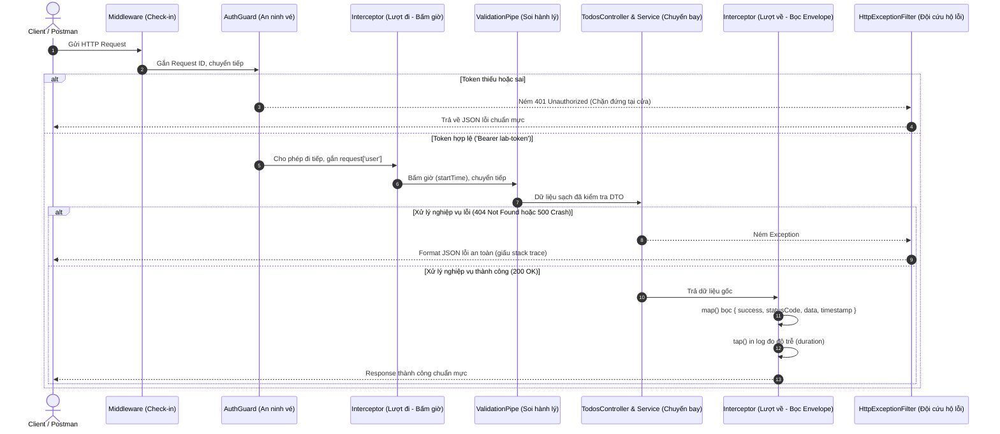

# Lời giải & Phân tích chuyên sâu — Hands-on Lab

Tài liệu này cung cấp toàn bộ mã nguồn lời giải chuẩn mực, phân tích kiến trúc chi tiết và giải thích lý do đằng sau từng dòng code cho bài thực hành **"Kiểm soát Request Lifecycle với Custom Guard, Interceptor và Exception Filter"**.

---

## 1. Bản chất kiến trúc: Vòng đời của một Request

Như đã chia sẻ trong cuốn sách *NestJS — Nền tảng (Mtikcode)*, điểm đáng giá nhất của NestJS là **buộc bạn viết code có tổ chức theo nguyên lý Single Responsibility (Đơn trách nhiệm)**. Thay vì dồn mọi thứ vào Controller như Express thuần, mỗi trạm kiểm soát trong NestJS đảm nhận một nhiệm vụ riêng biệt:



---

## 2. Chi tiết mã nguồn lời giải

### 2.1 Thành phần 1: `AuthGuard` (`src/common/guards/auth.guard.ts`)

```typescript
import {
  CanActivate,
  ExecutionContext,
  Injectable,
  UnauthorizedException,
} from '@nestjs/common';
import { Request } from 'express';

@Injectable()
export class AuthGuard implements CanActivate {
  canActivate(context: ExecutionContext): boolean {
    // 1. Chuyển ngữ cảnh sang HTTP và lấy Request
    const request = context.switchToHttp().getRequest<Request>();

    // 2. Trích xuất header Authorization
    const authHeader = request.headers['authorization'];

    // 3. Kiểm tra thiếu header
    if (!authHeader) {
      throw new UnauthorizedException('Bạn chưa cung cấp token xác thực!');
    }

    // 4. Kiểm tra token giả lập hợp lệ
    if (authHeader !== 'Bearer lab-token') {
      throw new UnauthorizedException('Token xác thực không hợp lệ!');
    }

    // 5. Gắn thông tin người dùng định danh vào request
    request['user'] = {
      id: 1,
      username: 'lab-user',
      role: 'LEARNER',
    };

    // 6. Cho phép request tiến vào các tầng tiếp theo
    return true;
  }
}
```

> [!NOTE]
> **Điểm cần nhớ:** Guard trong NestJS trả về `false` sẽ tự động sinh mã lỗi `403 Forbidden`. Vì vậy, khi client gửi token sai hoặc không gửi token, việc chủ động `throw new UnauthorizedException(...)` là bắt buộc để API trả về đúng chuẩn **401 Unauthorized**.

---

### 2.2 Thành phần 2: Interceptors (`LoggingInterceptor` & `TransformInterceptor`)

#### A. Đo lường thời gian: `LoggingInterceptor` (`src/common/interceptors/logging.interceptor.ts`)

```typescript
import {
  CallHandler,
  ExecutionContext,
  Injectable,
  Logger,
  NestInterceptor,
} from '@nestjs/common';
import { Request, Response } from 'express';
import { Observable } from 'rxjs';
import { tap } from 'rxjs/operators';

@Injectable()
export class LoggingInterceptor implements NestInterceptor {
  private readonly logger = new Logger(LoggingInterceptor.name);

  intercept(context: ExecutionContext, next: CallHandler): Observable<any> {
    const ctx = context.switchToHttp();
    const req = ctx.getRequest<Request>();
    const res = ctx.getResponse<Response>();

    const method = req.method;
    const url = req.originalUrl || req.url;
    const startTime = Date.now();

    return next.handle().pipe(
      tap({
        next: () => {
          const duration = Date.now() - startTime;
          const statusCode = res.statusCode || 200;
          this.logger.log(`[${method}] ${url} - Status: ${statusCode} - ${duration}ms`);
        },
        error: (err: any) => {
          const duration = Date.now() - startTime;
          const message = err?.message || 'Unknown error';
          this.logger.error(`[${method}] ${url} - FAILED - ${duration}ms - Error: ${message}`);
        },
      }),
    );
  }
}
```

#### B. Chuẩn hóa Envelope: `TransformInterceptor` (`src/common/interceptors/transform.interceptor.ts`)

```typescript
import {
  CallHandler,
  ExecutionContext,
  Injectable,
  NestInterceptor,
} from '@nestjs/common';
import { Response } from 'express';
import { Observable } from 'rxjs';
import { map } from 'rxjs/operators';

export interface ResponseFormat<T> {
  success: boolean;
  statusCode: number;
  data: T;
  timestamp: string;
}

@Injectable()
export class TransformInterceptor<T>
  implements NestInterceptor<T, ResponseFormat<T>>
{
  intercept(
    context: ExecutionContext,
    next: CallHandler,
  ): Observable<ResponseFormat<T>> {
    const response = context.switchToHttp().getResponse<Response>();

    return next.handle().pipe(
      map((data: T) => ({
        success: true,
        statusCode: response.statusCode || 200,
        data,
        timestamp: new Date().toISOString(),
      })),
    );
  }
}
```

> [!TIP]
> **Phân biệt `tap` và `map` trong RxJS:**
> * `tap()`: Dùng để **quan sát (nghe lén)** luồng dữ liệu (ghi log, đo thời gian) mà tuyệt đối không biến đổi giá trị trả về.
> * `map()`: Dùng để **biến đổi** giá trị dữ liệu trả về từ Controller thành cấu trúc mới trước khi đến tay Client.

---

### 2.3 Thành phần 3: `HttpExceptionFilter` (`src/common/filters/http-exception.filter.ts`)

```typescript
import {
  ArgumentsHost,
  Catch,
  ExceptionFilter,
  HttpException,
  HttpStatus,
  Logger,
} from '@nestjs/common';
import { Request, Response } from 'express';

@Catch()
export class HttpExceptionFilter implements ExceptionFilter {
  private readonly logger = new Logger(HttpExceptionFilter.name);

  catch(exception: unknown, host: ArgumentsHost) {
    const ctx = host.switchToHttp();
    const response = ctx.getResponse<Response>();
    const request = ctx.getRequest<Request>();

    let status = HttpStatus.INTERNAL_SERVER_ERROR;
    let message: string | object =
      'Đã có lỗi hệ thống xảy ra, vui lòng thử lại sau!';

    // 1. Ngoại lệ HTTP có kiểm soát (400, 401, 404, 409...)
    if (exception instanceof HttpException) {
      status = exception.getStatus();
      const res = exception.getResponse();

      if (typeof res === 'string') {
        message = res;
      } else if (typeof res === 'object' && res !== null && 'message' in res) {
        message = (res as any).message;
      } else {
        message = res;
      }
    } else {
      // 2. Lỗi crash ngoài ý muốn (Error thuần)
      this.logger.error('CRASH UNEXPECTED EXCEPTION:', exception);
    }

    // 3. Format JSON an toàn tuyệt đối, không lộ stack trace
    response.status(status).json({
      success: false,
      statusCode: status,
      message,
      path: request.originalUrl || request.url,
      timestamp: new Date().toISOString(),
    });
  }
}
```

> [!WARNING]
> **Nguyên tắc ném lỗi bảo mật:** Đừng bao giờ trả trực tiếp `error.stack` về cho client trên môi trường production. Stack trace tiết lộ chi tiết tên file, cấu trúc thư mục và dòng code bị lỗi — tạo điều kiện cho hacker thăm dò lỗ hổng hệ thống.

---

## 3. Đối chiếu Ma trận Kiểm thử T01–T06

| Mã Test | Tình huống | Thành phần kiểm soát | Kết quả mong đợi |
| :--- | :--- | :--- | :--- |
| **T01** | Token hợp lệ (`Bearer lab-token`), gọi `GET /todos` | `AuthGuard` $\to$ `LoggingInterceptor` $\to$ `TransformInterceptor` | HTTP 200, Envelope `{ success: true, statusCode: 200, data: [...], timestamp }` |
| **T02** | Thiếu token, gọi `GET /todos` | `AuthGuard` $\to$ `HttpExceptionFilter` | HTTP 401, JSON `{ success: false, statusCode: 401, message: "Bạn chưa cung cấp...", path, timestamp }` |
| **T03** | Token sai (`Bearer invalid`), gọi `GET /todos` | `AuthGuard` $\to$ `HttpExceptionFilter` | HTTP 401, JSON `{ success: false, statusCode: 401, message: "Token xác thực...", path, timestamp }` |
| **T04** | Tìm ID không tồn tại `GET /todos/999` | `TodosService` (404) $\to$ `HttpExceptionFilter` | HTTP 404, JSON `{ success: false, statusCode: 404, message: "Không tìm thấy...", path, timestamp }` |
| **T05** | Endpoint chậm `GET /todos/slow-endpoint` | `LoggingInterceptor` (RxJS `tap`) | HTTP 200, console server in log thời gian $\ge 300\text{ms}$ |
| **T06** | Lỗi crash `GET /todos/trigger-error` | `HttpExceptionFilter` | HTTP 500 an toàn, terminal ghi error, client **không có stack trace** |

---

## 4. Bài tập mở rộng & Thử thách tự học

### Bài tập 1: Custom Parameter Decorator `@CurrentUser()`
* **Yêu cầu:** Tạo file `src/common/decorators/current-user.decorator.ts` sử dụng hàm `createParamDecorator` của NestJS để lấy thông tin `request['user']` do `AuthGuard` gắn vào.
* **Gợi ý giải:**
  ```typescript
  import { createParamDecorator, ExecutionContext } from '@nestjs/common';
  
  export const CurrentUser = createParamDecorator(
    (data: string | undefined, ctx: ExecutionContext) => {
      const request = ctx.switchToHttp().getRequest();
      const user = request.user;
      return data ? user?.[data] : user;
    },
  );
  ```

### Bài tập 2: Đo lường thời gian cho cả trường hợp phát sinh lỗi
* **Yêu cầu:** Mở rộng `LoggingInterceptor` để khi Service ném lỗi (ví dụ 404 hoặc 500), interceptor vẫn tính được chính xác thời gian đã chạy từ lúc vào cho tới lúc văng lỗi.
* **Gợi ý giải:** Nhánh `error: (err) => { ... }` bên trong toán tử `tap()` đã hỗ trợ việc này, bạn chỉ cần lấy `Date.now() - startTime`.

---

## 5. Câu hỏi ôn tập trắc nghiệm

**1. Trong một request bình thường, thứ tự thực thi nào sau đây là đúng?**
* A. Middleware $\to$ Interceptor $\to$ Guard $\to$ Pipe $\to$ Controller
* B. Middleware $\to$ Guard $\to$ Interceptor (lượt đi) $\to$ Pipe $\to$ Controller $\to$ Interceptor (lượt về)
* C. Guard $\to$ Middleware $\to$ Pipe $\to$ Controller $\to$ Filter
* D. Pipe $\to$ Guard $\to$ Interceptor $\to$ Controller

**2. Nếu hàm `canActivate()` của Guard ném ra một `UnauthorizedException`, điều gì sẽ xảy ra tiếp theo?**
* A. Request đi tiếp vào Interceptor nhưng bỏ qua Pipe.
* B. Request lập tức bị ngắt, bỏ qua toàn bộ Interceptor, Pipe, Controller và nhảy thẳng vào Exception Filter.
* C. Server bị dừng đột ngột (crash terminal).
* D. NestJS tự động gọi lại hàm đó lần thứ hai.

**3. Vì sao không nên dùng `tap()` để định dạng lại response trả về cho client?**
* A. Vì `tap()` chỉ dùng được với websocket.
* B. Vì `tap()` không trả về kết quả mới ra ngoài luồng Observable, muốn biến đổi dữ liệu phải dùng `map()`.
* C. Vì `tap()` làm chậm hiệu năng của Node.js.
* D. Vì NestJS cấm sử dụng `tap()`.

**4. Khi viết Global Exception Filter với `@Catch()`, kiểu dữ liệu của biến `exception` trong hàm `catch()` nên là gì?**
* A. `any` hoặc `unknown`
* B. `string`
* C. `HttpException`
* D. `Error`

---

### Đáp án trắc nghiệm:
* **1 — B:** Thứ tự chuẩn mực được kiểm chứng trong Request Lifecycle.
* **2 — B:** Guard chặn đứng request ngay trước cửa, nhảy thẳng vào Exception Filter.
* **3 — B:** `tap()` là hiệu ứng phụ (side-effect), chỉ `map()` mới biến đổi dữ liệu luồng.
* **4 — A:** `@Catch()` không truyền tham số sẽ bắt cả lỗi hệ thống không lường trước, nên kiểu dữ liệu phải là `unknown` và dùng `instanceof` để phân nhánh.
